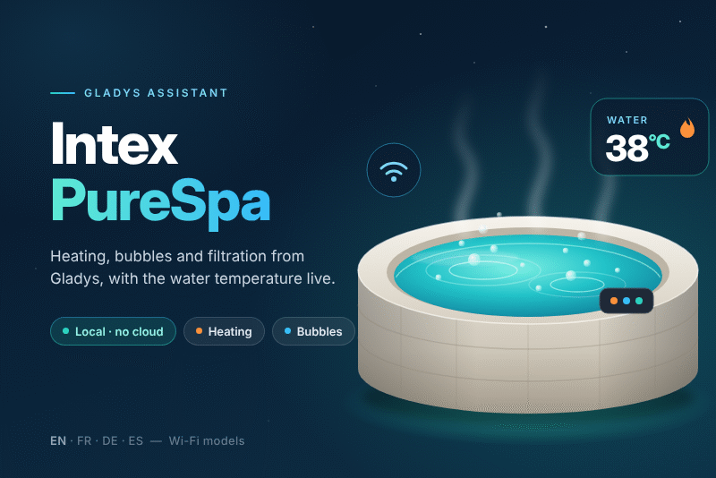

# Intex PureSpa for Gladys Assistant

External integration for [Gladys Assistant](https://gladysassistant.com) that drives
**Intex PureSpa** Wi-Fi spas **locally**, over the LAN: no Intex account, no cloud.



- Power, filtration, heater, bubbles, jets and salt sanitizer (per model)
- Target temperature (Celsius or Fahrenheit, detected from the spa) and water temperature
- Error code of the control panel (`E81`, `E90`...)
- Transport badge `local` / `unreachable`, connection status and **Test the connection**
- Scene triggers: **error detected**, **water temperature reached**, **spa no longer answers**
- Scene actions: **heat the spa to**, **read the spa status**
- Dashboard widget **Intex spa**: live temperatures, functions, quick buttons, target form
- English, French, German and Spanish

User documentation: [English](docs/en.md) · [Français](docs/fr.md) · [Deutsch](docs/de.md) ·
[Español](docs/es.md).

Requires **Gladys 5.3.0** or newer.

## How it works

The Wi-Fi module of the spa listens on **TCP 8990** and speaks small JSON messages carrying
hex frames (the protocol reverse-engineered by the community, reference implementation
[mathieu-mp/aio-intex-spa](https://github.com/mathieu-mp/aio-intex-spa), MIT). Every command
but the target temperature is a **toggle**, so the integration always reads the status first
and only sends what differs. The module serves one client at a time: a single connection is
kept open, requests are queued and retried.

## Project structure

```
.
├─ index.js                          # SDK bootstrap (no spa logic)
├─ src/
│  ├─ app.js                         # every handler, wired to { config, spa }
│  ├─ config.js                      # config defaults + normalization
│  ├─ connection.js                  # connection status + "Test the connection"
│  ├─ i18n.js                        # en / fr / de / es helpers
│  ├─ intex/
│  │  ├─ protocol.js                 #   frames, checksum, status decoding
│  │  ├─ client.js                   #   TCP client (queue, retries, reconnection)
│  │  └─ spa.js                      #   SpaController: wishes -> toggles, events
│  ├─ devices/
│  │  ├─ index.js                    #   registry, discovery, transports, poller
│  │  └─ spa.js                      #   the spa device and its features
│  └─ capabilities/
│     ├─ scenes.js                   #   scene triggers and actions (Gladys 5.1+)
│     └─ widget.js                   #   dashboard widget (Gladys 5.1+, forms 5.3+)
├─ docs/                             # user documentation (en, fr, de, es)
├─ test/                             # node --test, fake Gladys + fake spa on 127.0.0.1
├─ gladys-assistant-integration.json # manifest
├─ Dockerfile                        # Node 24 Alpine, read-only rootfs ready
├─ CHANGELOG.md                      # Keep a Changelog, rolled by the Release workflow
├─ CLAUDE.md                         # rules for coding assistants and contributors
├─ SECURITY.md                       # how to report a vulnerability privately
├─ .github/workflows/ci.yml          # format, lint, tests (Node 22 + 24), store checks, Docker
├─ .github/workflows/release.yml     # UI-driven release: bump + changelog + tag + build
├─ .github/workflows/build.yml       # multi-arch image (amd64 + arm64) to ghcr.io
├─ .github/workflows/github-release.yml # GitHub Release of every version tag
├─ .github/scripts/changelog-release.mjs # rolls [Unreleased] into the released version
├─ .github/dependabot.yml            # npm weekly, GitHub Actions + Docker monthly
└─ cover.png                         # catalog cover, 800×534 px
```

## Run it locally

```bash
npm install
GLADYS_HOST_API_URL="http://localhost:1443" \
GLADYS_INTEGRATION_TOKEN="<token>" \
GLADYS_INTEGRATION_SELECTOR="intex-purespa" \
LOG_LEVEL=debug \
npm start
```

## Quality checks

```bash
npm run format:check   # Prettier
npm run lint           # ESLint
npm test               # node --test: protocol, client, controller, device, scenes, widget, app
```

The tests need no spa and no network: `test/helpers/fakeSpa.js` is a fake Wi-Fi module on
127.0.0.1 speaking the real protocol (frames checked against captures of real spas), and the
SDK's `createFakeGladys()` plays Gladys.

Before tagging, the store validator can be run locally:

```bash
npx github:GladysAssistant/integration-store --skip-image-check .
```

## Publish

1. Add the GitHub topic `gladys-assistant-integration` to the repository and turn on
   **Private vulnerability reporting** (see [SECURITY.md](SECURITY.md)).
2. Describe the changes under `## [Unreleased]` in [CHANGELOG.md](CHANGELOG.md).
3. **Actions → Release → Run workflow**: pick `major` for the first release (0.0.0 → 1.0.0),
   then `patch` / `minor` / `major`. The workflow bumps `package.json` and the manifest, rolls
   the changelog, tags `vX.Y.Z`, builds the `linux/amd64` + `linux/arm64` image to
   `ghcr.io/prohand/gladys-intexpurespa`, publishes the GitHub Release, then runs the store
   checks against the published image.
4. Make the `ghcr.io` package public (Packages → Package settings → Change visibility), once.

The decentralized indexer picks up the new manifest `version` and Gladys offers the install.

## License

Apache-2.0. The protocol knowledge comes from
[aio-intex-spa](https://github.com/mathieu-mp/aio-intex-spa) (MIT, © Mathieu Payrol).
